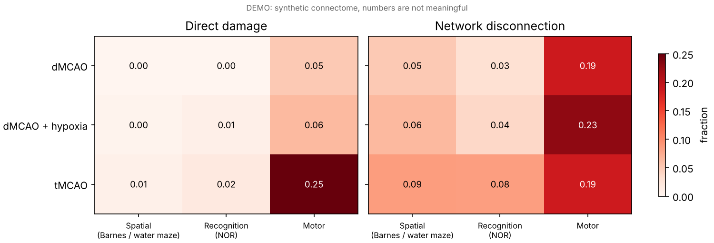
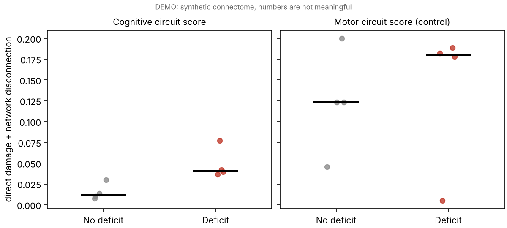

# Connectome-informed disconnection scores for mouse stroke models

[](https://github.com/marijaratti/using-allen-mouse-brain-connectivity-to-calculate-disconnection-score-for-modelling-strokes/actions/workflows/tests.yml)


**Why do some mouse stroke models produce memory deficits and others don't, even when the lesion never touches the hippocampus?**

A stroke damages more than the tissue it kills. It also cuts the connections between that tissue and the rest of the brain. This project uses the Allen Mouse Brain Connectivity Atlas to estimate how strongly a given lesion **disconnects** the circuits behind common behavioural tests (Barnes maze, water maze, novel object recognition), not just how much of those circuits it destroys directly.

It was built to think through the three stroke models compared in the multi-centre study by Brezzo et al. (2025): permanent distal MCAO (dMCAO), dMCAO with hypoxia, and transient filament MCAO (tMCAO). In that study, only dMCAO mice showed a significant Barnes maze deficit, and no model showed a deficit in novel object recognition.

---

## The idea in one picture

```
            lesion (e.g. somatosensory cortex)
                 │  ╲
   direct damage │   ╲  connections to the circuit
   (often zero)  │    ╲
                 ▼     ▼
        ┌──────────────────────────┐
        │  spatial memory circuit  │   hippocampus, entorhinal,
        │  CA1 · DG · ENT · RSP …  │   subiculum, retrosplenial …
        └──────────────────────────┘
```

For each stroke model and each functional circuit, two numbers are calculated:

| Score | Meaning |
|---|---|
| **Direct damage** | Mean fraction of the circuit's own regions that are damaged |
| **Network disconnection** | Share of the circuit's connections with the rest of the brain that run to or from damaged tissue, weighted by how badly each partner region is damaged |

In symbols, with connection matrix *W*, lesion fractions *f* and circuit *C*:

```
s_j  = Σ_{i∈C} ( W[j,i] + W[i,j] )          total wiring between region j and the circuit
direct(C)  = mean_{i∈C} f_i
network(C) = Σ_{j∉C} s_j · f_j  /  Σ_{j∉C} s_j
```

The motor circuit (MOp, MOs, caudoputamen, ventral anterior-lateral thalamus) works as a control. A score that predicts cognitive deficits should do it through the *cognitive* circuit, not by tracking overall stroke severity.

---

## Quick start

```bash
git clone https://github.com/marijaratti/using-allen-mouse-brain-connectivity-to-calculate-disconnection-score-for-modelling-strokes.git
cd using-allen-mouse-brain-connectivity-to-calculate-disconnection-score-for-modelling-strokes
pip install -r requirements.txt

python -m disconnect models     # three stroke models x three circuits
python -m disconnect studies    # score a set of coded studies, deficit vs no deficit
python -m pytest -q             # tests (~2 s)
```

With no connectome supplied, both commands run on a **small synthetic demo connectome** bundled in `disconnect/data/`. It uses real Allen atlas region names and roughly realistic wiring, but its numbers are random. It only exists so the code runs out of the box. Every figure made from it is stamped "DEMO".

### Example output (demo connectome)



`models` writes `model_scores.csv`, `top_contributors.json` (the lesioned regions that drive each model's disconnection of the spatial circuit) and the figure above.

`studies` writes `study_scores.csv`, `deficit_tests.csv` (Mann-Whitney U and point-biserial correlation, on all rows and on one row per paper) and a strip plot:



---

## Using the real Allen connectome

The real analysis uses the regional connectivity model from **Oh et al. (2014)**. That paper estimated normalised connection strengths between 213 regions in each hemisphere from 469 viral tracer injections in the Allen Mouse Brain Connectivity Atlas.

1. Download the supplementary connectivity matrices from the paper ([doi:10.1038/nature13186](https://doi.org/10.1038/nature13186)).
2. Save the **ipsilateral** strength matrix as a CSV, with region acronyms (e.g. `CA1`, `SSp-bfd`) as both row and column labels. Rows are source regions and columns are target regions. Extra non-numeric columns (such as a major-division label) are dropped automatically.
3. Run:

```bash
python -m disconnect models  --w-ipsi path/to/W_ipsi.csv
python -m disconnect studies --w-ipsi path/to/W_ipsi.csv --coding path/to/your_study_coding.json
```

Only the ipsilateral matrix is used, because these stroke models are unilateral and the question is about the lesioned hemisphere's own circuits.

## Inputs you can change

**`configs/brezzo_models.json`** sets the lesion extent of each stroke model (fraction of each region damaged) and the regions that make up each circuit. The lesion values are **illustrative assumptions** based on the histology summary in Brezzo et al. and typical territories for each model. A proper analysis would replace them with region-by-region histology.

**`examples/study_coding_example.json`** shows the format for the multi-study analysis. Each study lists the regions its lesion affected (`"extensive"` or `"partial"`, mapped to fractions by `coding_rules`), the circuit its behavioural test depends on, and whether it reported a deficit (`1`/`0`). **The studies in this file are invented to show the format.** They are not real papers.

## Limitations

- Lesion extents are coded coarsely (partial vs extensive) or assumed, not measured voxel-wise.
- The Oh et al. model is a regional, population-average estimate from young adult male C57BL/6J mice. It doesn't reflect age, sex or strain differences, or post-stroke rewiring.
- Network disconnection counts only one-step (direct) connections, not multi-step paths.
- A literature-coded sample is small and studies are not independent. That's why results are also reported with one row per paper.

## Repository layout

```
disconnect/
  scores.py      direct damage, network disconnection, per-region contributions
  analyses.py    stroke-model scoring, multi-study scoring and group comparisons
  io.py          tolerant CSV loader for connectome matrices
  plots.py       figures
  synthetic.py   generator for the bundled demo connectome
  __main__.py    command-line interface
configs/         stroke-model lesion and circuit definitions
examples/        study-coding format example
tests/           pytest suite (includes a hand-checked worked example)
```

## References

- Brezzo G., Zera K.A., Straus D.E. *et al.* (2025). Assessing post-stroke cognition in pre-clinical models: lessons and recommendations from a multi-center study. *Journal of Cerebral Blood Flow & Metabolism*. [doi:10.1177/0271678X251400241](https://doi.org/10.1177/0271678X251400241)
- Oh S.W., Harris J.A., Ng L. *et al.* (2014). A mesoscale connectome of the mouse brain. *Nature* 508, 207–214. [doi:10.1038/nature13186](https://doi.org/10.1038/nature13186)

## Licence

MIT (see [LICENSE](LICENSE)). The licence covers this code only. The Allen connectivity data is subject to the Allen Institute's terms of use.
